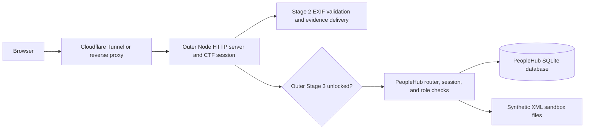

# Platform and box architecture

This document records the architecture of the existing integrated Solstice CTF
application. This member branch supplies the components listed in
[the contribution scope](contributions/IT24104133.md); the outer server and the
remaining stages are integrated separately.

## Request flow in the full project

The full project runs as one persistent Node.js HTTP process. In-memory sessions
and a persistent SQLite connection depend on that process remaining alive.
Plain HTML, CSS, and JavaScript pages are served without a frontend build step.

## Two session layers

The outer game uses `sid` to track story progress. Its server checks that Stage 3
is unlocked before serving `/peoplehub/*` or dispatching `/api/peoplehub/*`.
PeopleHub uses its own `phsid` cookie and server-side role checks for business
operations. Its challenge state is keyed by the outer session token so changing
PeopleHub accounts does not discard progress in the same outer run.

## Stage 2

`exif.js` reads JPEG metadata, `exif-write.js` updates text tags, and
`forensics.js` parses coordinate/date answers. The full outer seed prepares the
downloadable photo and answer data. The outer server protects the download with
the stage gate and performs the answer checks.

## PeopleHub

- `src/lib/peoplehub/router.js`: dispatch and the outer-server integration interface.
- `session.js`, `rbac.js`, and `helpers.js`: sessions, role capabilities, and request helpers.
- `challengeState.js`: progress for the nine PeopleHub challenge steps.
- `routes/`: business modules and intentionally vulnerable challenge behavior.
- `data/db/schema.sql` and `src/seed/`: schema and deterministic synthetic data generation.
- `data/challenge-data/`: synthetic files used by the import challenge.
- `public/peoplehub/shared/`: reusable API client, navigation, layout, and table helpers.

`db.js` opens the database lazily and reuses the connection. Reset closes it,
executes the PeopleHub seed, and allows the next query to reopen it.

## Shared hosting contract

In the complete app the admin/reset endpoints depend on a loopback check.
A same-host reverse proxy must block `/ctf-admin.html` and `/api/ctf-admin/*`
from public requests. Deployment configuration is a separate group contribution.

Use Node.js 22.5 or newer for `node:sqlite`, regardless of older Node 18 comments
in some source files. Generated databases and runtime logs do not belong in Git.
